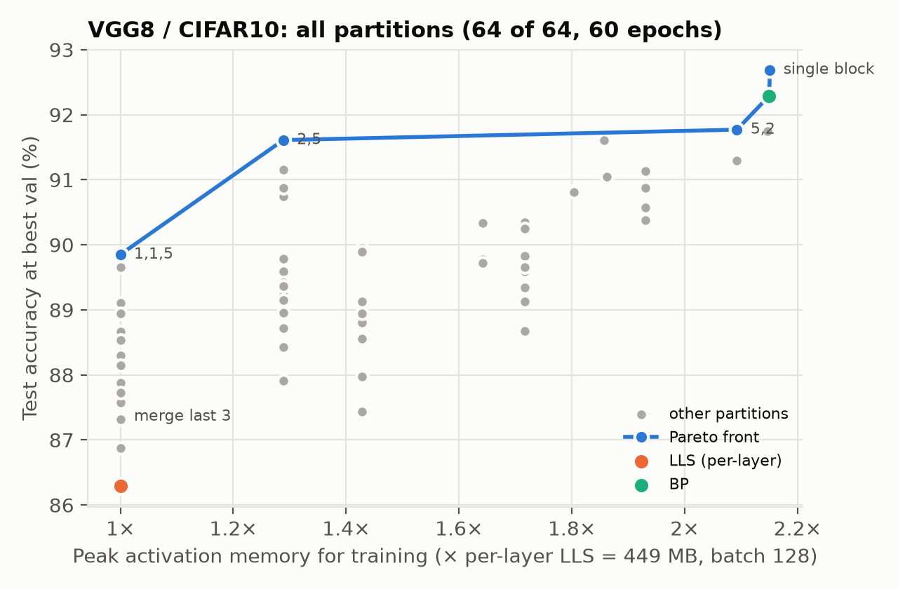
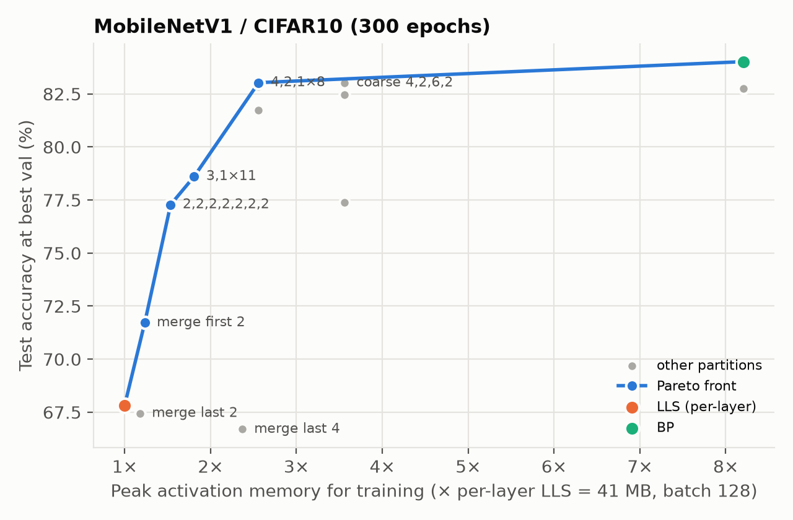
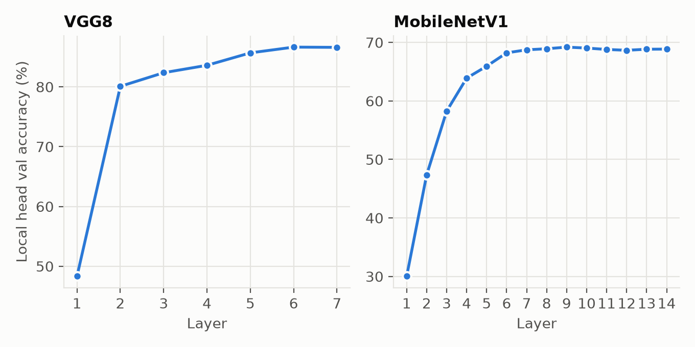
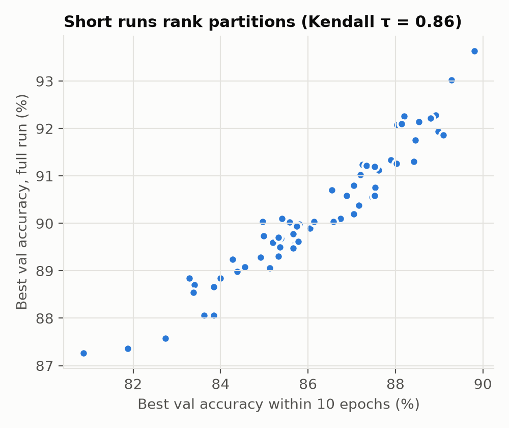
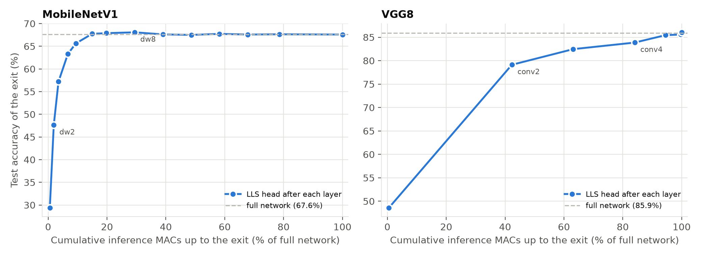
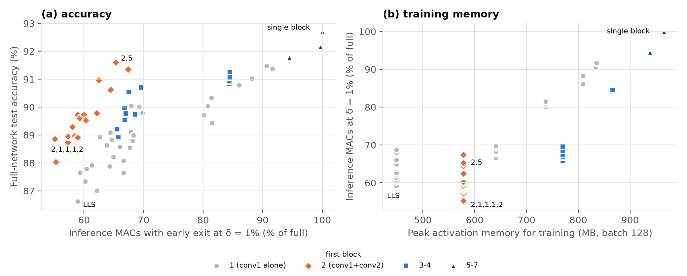
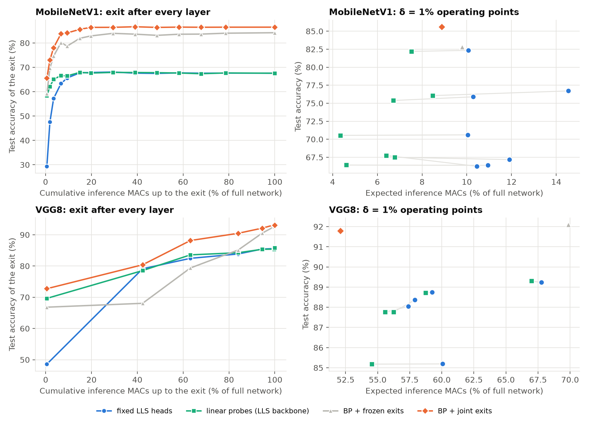
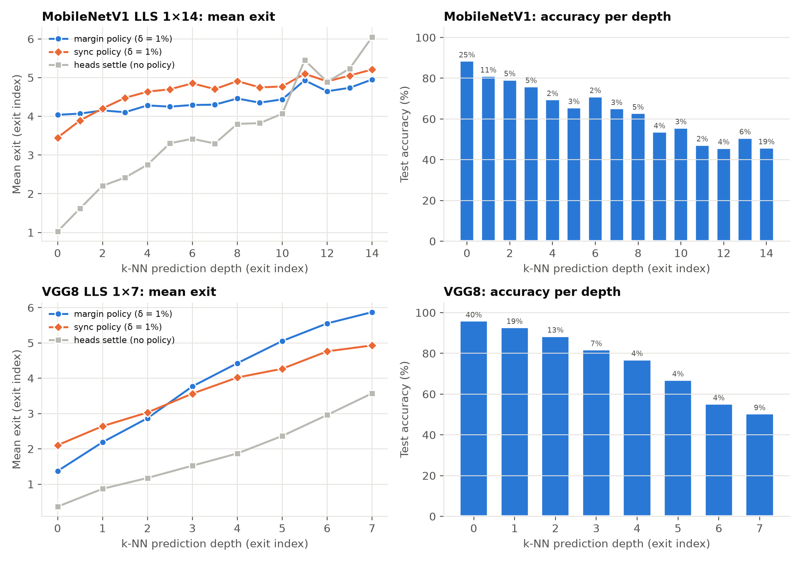

# Exploring LLS: Granularity, Early Exit and Scaling LLS

CS6886 (Systems Engineering for Deep Learning), IIT Madras. Yukash (CS23B069), Hayagriv.

LLS (Apolinario et al., WACV 2025) trains every layer with its own local loss against a fixed periodic basis, so
training needs no end-to-end backprop and much less activation memory, at a cost in accuracy. This project asks:

1. **Granularity.** Can a block of layers share one LLS head (BP inside the block, LLS between blocks), and which
   grouping gives the best accuracy for a given training memory?
2. **Early exit.** Every LLS head already predicts the class. Can these heads serve as free exits at inference, and are
   they interpretable?
3. **Scalability.** Does LLS scale to ResNet? <!-- TODO (Hayagriv) -->

Main results: merging the first layers closes 89% of the LLS–BP accuracy gap on VGG8 at 1.29× the per-layer LLS
memory, and 94% on MobileNetV1 at 2.56× (BP needs 8.21×). Used as exits, the LLS heads cut MobileNetV1's inference
MACs by 85–90% and VGG8's by 32–43%, within one point of full accuracy.

**Reports:** [Report](docs/short_report.pdf) · [Detailed report](docs/report.pdf)

The upstream LLS code is included unmodified in `third_party/LLS-DNN` (MIT).

## Setup
```bash
pip install -r requirements.txt
export WANDB_API_KEY=...                # optional; every run also logs to local files
export LLS_DATA=./data LLS_OUT=./runs   # optional; these are the defaults
python -m pytest -q                     # CPU unit tests
```
CIFAR10/100 are downloaded to `$LLS_DATA` on first use. Every command below skips finished runs and resumes
interrupted ones, so it is safe to re-run.

## Reproducing the results

### 1. Granularity (`lls_granular`)

**A single run**
```bash
python -m lls_granular.run --arch vgg8 --dataset cifar10aug --partition 2,5 --epochs 60
```

| Argument | Values | Meaning |
|---|---|---|
| `--arch` | `vgg8` (7 layers), `mobilenet` (MobileNetV1, 14 layers) | network |
| `--dataset` | `cifar10aug` (default), `cifar10` (no augmentation), `cifar100aug` | dataset |
| `--partition` | `uniform:1` (default) | per-layer LLS: one head per layer, as in the paper |
| | `uniform:k` | blocks of `k` consecutive layers; the remainder forms the last block |
| | `aligned` | cut wherever the spatial resolution changes (at the pooling layers) |
| | sizes, e.g. `2,5` or `4,2,1,1,1,1,1,1,1,1` | explicit block sizes; they must sum to the number of layers |
| | `uniform:7` (VGG8) / `uniform:14` (MobileNet) | one block over the whole network (one LLS head at the end) |
| | `bp` | plain backprop baseline |
| `--epochs` | default 100 | training epochs |
| `--seed` | default 0 | random seed |
| `--lr`, `--wd`, `--optim` | `5e-3`, `0`, `AdamWSF` | schedule-free AdamW (as in the paper) |
| `--wave`, `--temp` | `square` / `cosine`, `0.5` | LLS basis shape and softmax temperature |
| `--bs` | default 128 | batch size |
| `--limit N` | | train on N images only (smoke test) |
| `--no-wandb`, `--fresh` | | disable wandb; restart the run from scratch |

Each run writes `runs/<run>/` (`config.json`, `metrics.csv`, `summary.json`, `run.log`, `ckpt.pt`) and logs to the
wandb project `lls-granularity` as `{arch}_{dataset}_{p<blocks>|bp}_e{epochs}_s{seed}`.

**All experiments in the report.** `lls_granular.launch` runs a named experiment on all visible GPUs (one run per GPU)
and prints a results table. Several experiments can share one queue: `python -m lls_granular.launch cifar100 seeds`.

| Command | Runs |
|---|---|
| `python -m lls_granular.launch smoke` | 2-epoch sanity check on 1k images |
| `python -m lls_granular.launch sweep` | all 64 VGG8 partitions, 60 epochs (epoch 10 is the cheap proxy) |
| `python -m lls_granular.launch main` | VGG8, 300 epochs: LLS, BP, `uniform:2/3/7`, `aligned`, `2,2,3` |
| `python -m lls_granular.launch seeds` | VGG8, 60 epochs: LLS, `1,1,5`, `2,5`, one block, BP × seeds 1–2 |
| `python -m lls_granular.launch cifar100` | VGG8 / CIFAR100: LLS, `aligned`, BP, `1,1,5`, `2,5` |
| `python -m lls_granular.launch mobilenet300` | MobileNetV1, 300 epochs: LLS, BP, `uniform:2`, `aligned`, one block, early/late merges, `4,2,6,2` |
| `python -m lls_granular.launch mobilenet_gap` | MobileNetV1, 300 epochs: `3,1×11`, `4,1×10`, `4,2,1×8`, `4,2,2,2,2,2`, `4,2,6,1,1` |
| `python -m lls_granular.measure --arch vgg8` (or `mobilenet`) | training memory and MACs of every partition |

`launch` flags: `--seeds 0 1 2`, `--gpus N`, `--dry-run` (list the runs), `--restore DIR` (resume from an earlier
`runs/` folder, e.g. a previous Kaggle output), and `-- <flags>` passed to every run (e.g. `-- --no-wandb`). The
experiments are defined in `lls_granular/exps.py`.

**Figures and tables:** `python -m lls_granular.analyze --out report/granularity` pulls the finished runs from wandb
and writes the accuracy–memory fronts, per-layer head accuracy, proxy ranking, memory-budget picks, CSV tables and
`results.md`. Missing experiments are skipped.

### 2. Early exit (`lls_exit`)

The early-exit study reuses the trained granular checkpoints; only the comparison exits are trained. Dependencies:

```
trained checkpoints ──> exit dumps ──> stopping-rule sweep ─┬─> figures and tables
        │                   │      └─> diagnostics ─────────┤
        │                   └────────> prediction depth ────┘   (also needs the sweep's picks.csv)
        └─> learned exits (frozen) ──> sweep / diagnostics with --runs
learned exits (joint): no dependency
```

**Exit dumps** (GPU; needs: trained checkpoints). Saves every head's logits on val/test once, with per-exit MACs.
```bash
python -m lls_exit.dump --exp mobilenet300      # 8 MobileNet partitions
python -m lls_exit.dump --exp main              # 6 VGG8 partitions
python -m lls_exit.dump --exp sweep             # all 64 VGG8 partitions (optional)
python -m lls_exit.dump --run-dir runs/<run>    # a single run
```

| Argument | Meaning |
|---|---|
| `--exp E ...` / `--run-dir DIR` | every non-BP run of these experiments / one run folder |
| `--seeds S ...` | with `--exp`: the seeds the runs used |
| `--n-train N` | class-balanced train subset kept for prediction depth (default 10k, 0 = none) |
| `--no-feats` | skip saving head inputs (`feats.pt`, needed only for prediction depth) |
| `--fresh`, `--partial`, `--upload-only` | redo; dump unfinished runs; re-upload existing dumps |
| `--limit N`, `--no-wandb`, `--workers 0` | smoke test; local only; if `/dev/shm` is full |

Outputs next to each `ckpt.pt`: `exits.pt`, `feats.pt`, `exit_summary.json`, and an `exits-<run>` artifact on wandb.

**Stopping-rule sweep** (CPU; needs: dumps). Evaluates confidence, entropy, margin, patience, sync and
sync + margin over 41 thresholds each, plus static truncation and the oracle, and picks the cheapest validation setting
within δ ∈ {0, 0.5, 1, 2}% of the full network.
```bash
python -m lls_exit.sweep --exp mobilenet300 --out report/exit/mobilenet
python -m lls_exit.sweep --exp main         --out report/exit/vgg8
python -m lls_exit.sweep --exp sweep        --out report/exit/vgg8_sweep
```

| Argument | Meaning |
|---|---|
| `--exp E ...` / `--runs NAME ...` | experiments, or run names (e.g. the learned-exit runs) |
| `--dumps DIR` | read `DIR/<run>/exits.pt` instead of downloading the wandb artifacts |
| `--n` | thresholds per rule (default 41) |
| `--out` | output folder: `sweep.csv.gz`, `pareto.csv`, `picks.csv`, `temps.json` |

**Diagnostics** (CPU; needs: dumps): per-exit accuracy and calibration (ECE), overthinking, per-class settle depth,
basis orthogonality. Same `--exp` / `--runs` / `--dumps` / `--out` arguments, plus `--split val|test`.
```bash
python -m lls_exit.diag --exp mobilenet300 --out report/exit/mobilenet
```

**Learned exits** (GPU; baselines for the fixed LLS heads; `frozen` needs the trained checkpoints, `joint` needs nothing).
```bash
python -m lls_exit.train_exits --plan mobilenet_frozen   # linear probes on the LLS runs + frozen exits on BP
python -m lls_exit.train_exits --plan mobilenet_joint    # BP trained jointly with an exit after every layer
python -m lls_exit.train_exits --plan vgg8_frozen
python -m lls_exit.train_exits --plan vgg8_joint
```
Single runs: `--variant frozen --source runs/<run>` or `--variant joint --arch vgg8 --epochs 100 [--partition 2,2,3]`.
The resulting `exits.pt` has the same format, so the sweep and diagnostics run on them with `--runs <names>`.

**Prediction depth** (k-NN difficulty, Baldock et al. 2021) against exit depth (`knn` needs: dumps with `feats.pt`;
`analyze` also needs the sweep's `picks.csv`).
```bash
python -m lls_exit.depth knn --exp mobilenet300                                    # GPU, needs feats.pt
python -m lls_exit.depth analyze --exp mobilenet300 --out report/exit/mobilenet    # CPU, needs picks.csv
```

**Figures and tables** (needs: sweep and diagnostics outputs; learned-exit and depth outputs for those figures):
`python -m lls_exit.analyze` reads `report/exit/<set>/` and writes
`report/exit/figs/` and `report/exit/tables.md`.

## Key results

### Granularity

Merging the **first** layers is what recovers accuracy: the best partition on each network merges the early layers,
while merging late layers does not help. The best cut differs per model, so simple rules (uniform blocks, cuts at
pooling layers) are 2–2.5 points below the best partitions; partitions with equal memory differ by 2–3 points on
VGG8, against a seed std of 0.1–0.3.

**CIFAR10.** Mem. is peak training activation memory relative to per-layer LLS; gap closed is the share of the
LLS–BP accuracy gap recovered.

| VGG8 (60 epochs) | Acc. (%) | Gap closed | Mem. | | MobileNetV1 (300 epochs) | Acc. (%) | Gap closed | Mem. |
|---|---|---|---|---|---|---|---|---|
| Per-layer LLS | 86.2 | 0% | 1.00 | | Per-layer LLS | 67.8 | 0% | 1.00 |
| Uniform `2,2,2,1` | 89.4 | 53% | 1.29 | | Merge last 4 | 66.7 | −7% | 2.37 |
| `1,1,5` | 89.9 | 60% | 1.00 | | Uniform `2×7` | 77.3 | 58% | 1.54 |
| **`2,5`** | **91.6** | **89%** | **1.29** | | **`4,2,1×8`** | **83.0** | **94%** | **2.56** |
| BP | 92.3 | 100% | 2.15 | | BP | 84.0 | 100% | 8.21 |

**CIFAR100 (VGG8, 100 epochs).** The choice of partition matters more on the harder task: `2,5` matches BP.

| Partition | CIFAR10 (%) | CIFAR100 (%) |
|---|---|---|
| Per-layer LLS | 86.6 | 54.8 |
| `aligned` (`2,2,1,1,1`) | 89.6 | 59.4 |
| `1,1,5` | 89.9 | 63.8 |
| **`2,5`** | **91.6** | **67.1** |
| BP | 92.8 | 67.2 |

| Accuracy vs training memory, all 64 VGG8 partitions | MobileNetV1 partitions |
|---|---|
|  |  |

| Accuracy of each layer's own LLS head | Ranking partitions after 10 epochs vs after 60 |
|---|---|
|  |  |

Per-layer LLS heads stop improving after the first few layers (MobileNetV1 plateaus after layer 7), which is why
merging early layers helps and merging late ones does not. Ranking partitions after 10 epochs picks the best partition
in 4 of 5 memory budgets.

### Early exit

Within one point of full accuracy, the LLS heads cut inference MACs by **85–90% on MobileNetV1** and **32–43% on
VGG8**. VGG8 saves less because 42% of its MACs are in full-resolution early convolutions before its first useful exit.
The partition matters: on MobileNetV1, `4,2,6,2` reaches 82.3% at 10% of the MACs, versus 67.2% at 12% for per-layer
LLS. The stopping rule matters less, because the heads are already calibrated (ECE ≤ 0.08).

**Comparison with learned exits at δ = 1% (CIFAR10).** MACs as a fraction of the full network. LLS partitions:
`4,2,6,2` (MobileNetV1), `3,3,1` (VGG8).

| Exits | MobileNetV1 Acc. (%) | MACs | VGG8 Acc. (%) | MACs |
|---|---|---|---|---|
| Fixed LLS heads (ours) | 82.3 | 0.10 | 89.2 | 0.68 |
| Linear probes on LLS | 82.2 | 0.08 | 89.3 | 0.67 |
| BP, frozen exits | 82.8 | 0.10 | 92.1 | 0.70 |
| BP, jointly trained exits | 85.6 | 0.09 | 91.8 | 0.52 |

Fixed LLS heads match trained linear probes without any exit parameters; BP with jointly trained exits is better at
every cost, mainly because the BP networks are more accurate to begin with.

| Exit accuracy vs inference MACs | Inference saving vs accuracy, all 64 VGG8 partitions |
|---|---|
|  |  |

| Fixed heads vs learned exits | Exit depth vs sample difficulty (k-NN prediction depth) |
|---|---|
|  |  |

**Interpretability.** The heads are calibrated, so their confidence is a reliable exit signal; their per-layer
accuracy shows where the network stops improving, which tells us where to merge layers; and the exit a sample takes
follows its difficulty (Spearman 0.44–0.59 with k-NN prediction depth on VGG8). Weak exits come from confusable classes
(cat–dog), not from the basis, whose rows are nearly orthogonal.
